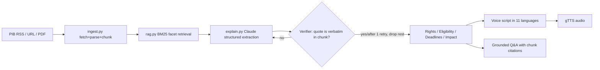

# Civic Pulse — Multilingual Policy, Rights & Scheme Explainer
Turns live government notifications into verified, plain-language, regional-language voice explainers.

## Architecture

**Guardrail:** every claim carries a verbatim source quote; unverifiable claims are retried once, then dropped and reported.
**No mock data:** all content is fetched live from the notice URL, uploaded PDF, or the PIB RSS feed (`NOTICE_FEED`).

## Run
```
pip install -r requirements.txt
export ANTHROPIC_API_KEY=...
streamlit run app.py
```
Deploy: push to GitHub → Streamlit Community Cloud / HF Spaces, add `ANTHROPIC_API_KEY` as a secret.
